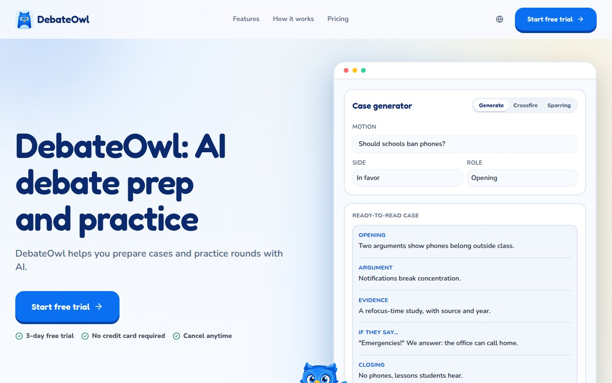

# Hi, I'm Ádám

I build AI products and keep them running, under the name **[Pi-Stack](https://pi-stack.org)**.

### DebateOwl: [debateowl.com](https://debateowl.com)
AI debate prep and practice for students. Pick the motion you're preparing, build a ready-to-read case for either side with cited evidence, then practise against the AI with crossfire drills and timed, judged sparring rounds. It works in English, Spanish and Hungarian.

**[Try it at debateowl.com](https://debateowl.com)** (3-day free trial, then $5/month; the [debate tools](https://debateowl.com/tools) are free) · **[Source on GitHub](https://github.com/Programcode/DebateOwl)** (source-available: run it for personal use, but don't host it publicly)

*React + Vite + TypeScript · Tailwind + Radix · Supabase (Postgres/RLS, Deno Edge Functions) · Claude via OpenRouter · Stripe · Vercel*

### More I've shipped

| Project | What it is |
|---|---|
| [**The Underwater City of Athel**](https://athel.pi-stack.org) | An interactive illustrated story where every choice moves Mira toward one of three endings |
| [**Escucha**](https://escucha.pi-stack.org) | A client project: an end-to-end encrypted, anonymous and bilingual reporting channel for a school community |
| [**ProtoPi**](https://proto.pi-stack.org) | Coding agents deploy HTML prototypes to a shareable link, and people comment on them (it has an MCP server for agents) |
| [**YubiNotes**](https://notes.pi-stack.org) | Notes that only open with a YubiKey (WebAuthn), with wikilinks, tags, graph view and a live Markdown editor |
| [**Chorely**](https://chorely.pi-stack.org) | A chore tracker where kids earn tokens toward rewards, with all data kept on the device |
| [**Status**](https://status.pi-stack.org) | A Cloudflare Worker that checks every Pi-Stack site every 5 minutes |

### What I work with
TypeScript · React · Next.js · Vite · Supabase · Postgres · Deno · Cloudflare Workers · Vercel · Python · Rust · Go · Swift. I also build with AI coding agents.

### Open-source contributions
- [**pulso**](https://github.com/Programcode/pulso) (fork of `lenilsonjr/pulso`): a CI workflow that builds an unsigned IPA for re-signing, plus a fixed background-refresh task ID so re-signed builds still sync
